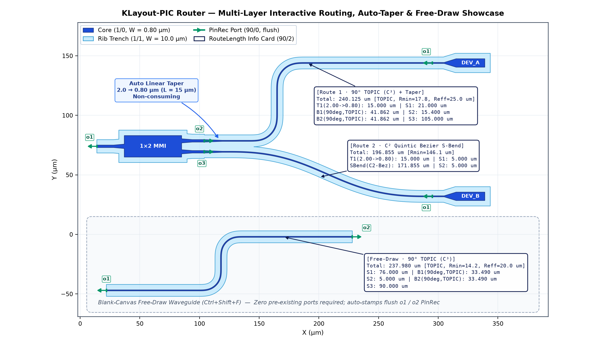
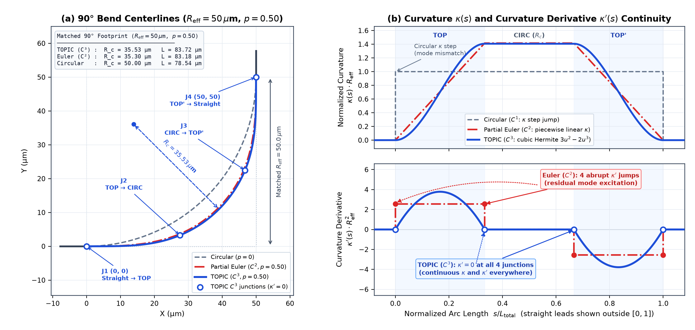
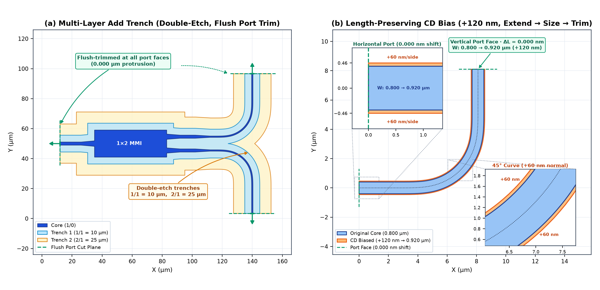

# KLayout-PIC Router

[](LICENSE)
[](https://www.klayout.de/)
[](#installation)
[](CHANGELOG.md)

[English](README.md) | [简体中文](README_zh.md)

**KLayout-PIC Router** (`pic_router`) is an interactive photonic integrated circuit (PIC) layout and waveguide routing plugin for **KLayout 0.28–0.30+**. It bridges visual drag-and-drop cell placement with mathematically exact multi-layer photonic routing—supporting flush `PinRec` port management, precision cell snapping and alignment, constant-width **TOPIC ($C^3$)** and **Partial Euler ($C^2$)** bends, **$C^2$ Quintic Bezier / Raised-Sine S-bends**, blank-canvas **Free-Draw** waveguides, post-layout multi-layer trench generation, and length-preserving CD linewidth compensation. Built in **100% pure Python** with **zero `numpy` or `scipy` dependencies**, it runs out of the box inside KLayout's embedded Python for SOI, SiN, InP, AlN, SiO₂/PLC, or any custom multi-layer photonic process.



---

## Key Features

- **Flush Port Management (`PinRec 90/0`)**: Cell-local, inward-flush port markers (`DPath` + `DText` + GDSII `PROPATTR` metadata) that never enlarge cell bounding boxes and survive GDSII save/reload. One-click **`Auto-Detect / Refresh Ports`** (`Ctrl+Shift+D`) scans cells (including mirrored and arbitrary-angle facets) and cleanly refreshes widths after CD bias or geometry edits, while **`Add Port (Click Edge)`** (`Ctrl+Shift+P`) stamps ports on any individual facet.
- **Precision Cell Alignment & Snapping**: Interactive **`Snap 2 Ports`** (`Ctrl+Shift+S`), 1-click **`Quick Snap Selected Cell`** (`Ctrl+Shift+K`), single-axis **`Align X`** (`Ctrl+Shift+X`) and **`Align Y`** (`Ctrl+Shift+Y`) for distortion-free straight routes, plus symmetric **`Center Pair (2->2)`** (`Ctrl+Shift+M`)—with full support for rotated and mirrored (`r0*`) instances.
- **Modern Curvature-Engineered Bends**:
  - **TOPIC ($C^3$ Hermite)** *(default)*: continuous curvature $\kappa$ **and** continuous curvature derivative with $\kappa' = 0$ at all four straight/transition/circular junctions, suppressing bend-transition mode mismatch.
  - **Partial Euler ($C^2$ clothoid)**: built-in 16-point Gauss–Legendre Fresnel integration matching `scipy.special.fresnel` to $< 10^{-13}$ with zero third-party packages.
  - **$C^2$ S-Bends**: zero-endpoint-curvature **Quintic Bezier** and **Raised-Sine** S-bends for offset parallel ports, plus optional **`Integer um Length`** analytical tuning without moving devices.
- **Pure-Straight Manual Routing & Blank-Canvas Free-Draw (`Ctrl+Shift+F`)**: Hold `Shift` for orthogonal H/V dragging, or type exact straight lengths directly on canvas (arrow key + digits + `Enter`/`Tab`, or via the Dock `Add Straight` bar) with lossless `Right-click` / `Backspace` undo. **`Free Draw Waveguide`** draws multi-layer TOPIC/Euler waveguides directly on a blank canvas with zero pre-existing ports and automatically stamps flush `o1`/`o2` `PinRec` ports on completion.
- **Multi-Layer Core/Trench & Persistent JSON User Presets**: Ships with three process-neutral starter templates (`Core Only (Single Layer)`, `Core + Trench (Rib)`, `Double Etch (2 Trenches)`), supports semicolon-separated multi-layer syntax (`1/1=10; 2/1=25`), and lets you **`Save`** / **`Del`** custom foundry presets directly from the Dock panel into `pic_router_presets.json`.
- **Non-Consuming Auto Linear Tapers**: When **`Auto Taper Port Widths`** is enabled and a port width differs from the routing `Core W`, a smooth linear taper (`Taper L`) is automatically inserted outside the straight waveguide and bend segments—never shortening your specified straight lengths (`S1`, `S2`, ...).
- **Collision-Free `RouteLength (90/2)` & `Routes (ΔL)` Inspector**: High-contrast dark navy (`#0F1C4D`) length and $R_{\min}/R_{\mathrm{eff}}$ annotations (`Compact Card`, `Per-Segment`, or `Total Only`), paired with the **`Routes (ΔL)`** dock tab for double-click zoom, Ctrl-click path-length difference ($\Delta L$) measurement, and clipboard export.
- **Post-Layout Mask Prep (`Add Trench` & Length-Preserving `CD Bias`)**:
  - **`Add Trench (Multi)...`** generates single- or multi-layer trenches around existing core-only devices, trimmed flush at port faces with zero protrusion.
  - **`CD Bias (ΔW nm)...`** applies isotropic or anisotropic X/Y linewidth compensation (`Extend -> Size -> Flush Trim`) uniformly across horizontal, vertical, and curved bends while holding port faces and optical path length strictly invariant (`0.000 nm` shift).
- **Standalone Parametric PCell Library (`PIC_Router`)**: Live-editable **`EulerWaveguide`**, **`TOPICBend`**, and **`EulerBend`** PCells, plus an interactive **`Create TOPIC Bend (90° / Custom)...`** dialog with real-time $R_c$, $\theta_p$, arc-length, and footprint readout.

---

## TOPIC ($C^3$) vs. Partial Euler ($C^2$) vs. Circular Bends

Constant-width **TOPIC** (*Transition-Optimal-Path Integrated Curve*) bends use a cubic Hermite curvature ramp $\kappa(u) = (3u^2 - 2u^3)/R_c$ ($u \in [0, 1]$) joined smoothly to a central circular arc of radius $R_c$ and mirrored exit ramp. Compared at identical footprint ($R_{\mathrm{eff}} = 50\,\mu\mathrm{m}$, transition fraction $p = 2\theta_p/|\theta_t| = 0.50$, i.e., $\theta_p = 22.5^\circ$ for a $90^\circ$ bend):

- **Circular ($C^1$)**: abrupt $\kappa$ step jumps at entry and exit cause strong straight-to-bend mode mismatch.
- **Partial Euler ($C^2$)**: continuous $\kappa(s)$, but exhibits **4 abrupt jumps in $\kappa'(s)$** at the straight/clothoid and clothoid/circle junctions.
- **TOPIC ($C^3$)**: continuous $\kappa(s)$ **and** $\kappa'(s) = 0$ at all four junctions, achieving smoother adiabatic mode evolution with a slightly larger minimum radius $R_c$ at the same effective footprint $R_{\mathrm{eff}}$.



> **Recommended Default**: `Bend Curve = TOPIC (C3)` with `Bend p = 0.50` ($\theta_p = 22.5^\circ$ for $90^\circ$ bends) provides a balanced trade-off between high $R_c / R_{\mathrm{eff}}$ retention ($\approx 0.71$) and smooth $C^3$ curvature transitions.

---

## Post-Layout Mask Prep: Multi-Layer Trench & Length-Preserving CD Bias



- **Multi-Layer Add Trench** *(left)*: Expands core-only structures (MMIs, splitters, bends, or entire cells) into one or more trench layers (`1/1=10; 2/1=25`) in a single operation and trims every trench cleanly flush with detected or `PinRec` port faces (`0.000 μm` protrusion). Supports both solid trenches and hollow sleeves (`Trench minus Core`).
- **Length-Preserving CD Bias** *(right)*: Compensates fabrication etch bias (e.g., `+120 nm` total / `+60 nm` per sidewall) isotropically across horizontal, vertical, and curved bends (or anisotropically in X/Y for orientation-dependent etches). Using an **Extend → Size → Flush Trim** pipeline, every port face and total centerline optical path length remains strictly invariant (`0.000 nm` shift).

---

## Installation

**Requirements**: KLayout **0.28, 0.29, or 0.30+** (Qt5 or Qt6). No external Python packages (`numpy`/`scipy`) are required.

### Option 1: Windows (1-Click Installer)

1. Download and extract the release archive (`KLayout-PIC-Router_v0.1.0.zip`) or clone this repository.
2. Double-click **`install_windows.bat`** (or run `scripts\install_windows.bat` from the repository root).
   - Installs into `%USERPROFILE%\KLayout\salt\pic_router` (or `%KLAYOUT_HOME%\salt\pic_router` if `KLAYOUT_HOME` is set).
   - To uninstall later: `scripts\install_windows.bat --uninstall`.
3. Restart KLayout.

### Option 2: Linux & macOS

From the repository root (or extracted release folder):

```bash
# Standard copy installation into ~/.klayout/salt/pic_router
bash scripts/install_linux_mac.sh

# Developer mode (symlink directly to your git checkout)
bash scripts/install_linux_mac.sh --symlink

# Check status or uninstall
bash scripts/install_linux_mac.sh --status
bash scripts/install_linux_mac.sh --uninstall
```

### Option 3: Manual Salt Installation

Copy `grain.xml`, `pymacros/`, and `python/` into your KLayout Salt package directory:

- **Windows**: `%USERPROFILE%\KLayout\salt\pic_router\`
- **Linux / macOS**: `~/.klayout/salt/pic_router/`

### Enable KLayout Editing Mode (Required for Layout Modifications)

KLayout defaults to Viewer mode on some installations. Enable Editing Mode once:

- **GUI**: `File -> Setup -> Application -> Editing Mode` → check **Editing mode by default**, click **OK**, and restart KLayout.
- **CLI**: Launch with `klayout -e`.

Once loaded, you will see the top-level **`PIC Tools`** menu and the right-hand **`PIC Snap & Router`** dock panel (toggle anytime with `Ctrl+Shift+T`).

---

## Quick Start & Workflow Guide

### 1. Cross-Section Presets & Custom JSON Presets

In **Cross-Section & Route Params**, select a built-in starter template or configure your own stack:

| Built-in Template | Core Layer & Width | Trench Layer(s) & Width | Default $R_{\mathrm{eff}}$ | Default $p$ | Min Straight |
| :--- | :--- | :--- | :---: | :---: | :---: |
| `Core Only (Single Layer)` | `1/0` (`0.50 μm`) | Disabled | `20.0 μm` | `0.50` | `5.0 μm` |
| `Core + Trench (Rib)` *(default)* | `1/0` (`0.80 μm`) | `1/1` (`10.0 μm`) | `50.0 μm` | `0.50` | `5.0 μm` |
| `Double Etch (2 Trenches)` | `1/0` (`0.80 μm`) | `1/1` (`10.0 μm`), `2/1` (`25.0 μm`) | `50.0 μm` | `0.50` | `5.0 μm` |

- **Multi-layer field syntax**: Both `Core L/D` and `Trench L/D` accept semicolon-separated layers with optional per-layer widths, e.g., `1/1=10; 2/1=25` or `1/0; 2/0=4.0`.
- **Save custom presets**: Tune widths, layers, `Radius`, `Bend p`, and `Min Straight`, then click **`Save`** next to the `Preset` dropdown. User presets persist in `pic_router_presets.json` inside your KLayout user directory and can be removed with **`Del`** (built-in templates are protected).

### 2. Free-Draw Waveguide on a Blank Canvas (`Ctrl+Shift+F`)

Draw multi-layer TOPIC or Euler waveguides directly without placing any devices first:

1. Click **`Free Draw Waveguide`** (or press `Ctrl+Shift+F`).
2. Click anywhere on the canvas to place the start point (quantized to `1 μm`; automatically snaps if clicked near an existing port).
3. Drag horizontally/vertically and click to add legs—or press an **Arrow key** (`← ↑ → ↓`), **type an exact length in μm** (e.g. `120.5`), and press **`Enter`** / **`Tab`** (or use the Dock **`Straight L (um)` + `Add Straight`** bar). Each perpendicular turn automatically inserts a $90^\circ$ TOPIC/Euler bend while preserving your exact pure straight lengths.
4. Undo any segment losslessly with **`Right-click`** or **`Backspace`**.
5. Press **`Enter`** (with an empty numeric buffer) or click an existing port to commit the live-editable `EulerWaveguide` PCell. Flush `o1` / `o2` `PinRec (90/0)` ports are automatically stamped at free endpoints so other cells can snap directly to your waveguide.

### 3. Port Auto-Detection & Refresh (`Ctrl+Shift+D`)

1. Select one or more cell instances (or leave nothing selected to scan the active cell) and click **`Auto-Detect / Refresh Ports`** (`Ctrl+Shift+D`).
2. Old `PinRec (90/0)` markers on the target cell(s) are replaced with fresh, inward-flush ports detected from the current core geometry—automatically updating recorded port widths after a **CD Bias** or manual edit so **`Auto Taper Port Widths`** never inserts spurious tapers.
3. For a single custom edge, use **`Add Port (Click Edge)`** (`Ctrl+Shift+P`) and click near any waveguide end face.
4. Inspect, filter, or assign persistent GDSII instance aliases via the **`World Ports`** dock tab (`Alias` button).

### 4. Precision Cell Alignment & Snapping

- **`Snap 2 Ports`** (`Ctrl+Shift+S`): Click a port on the movable cell, then click the target port. Toggle **`Allow Rotate on Snap`** to match opposite outward angles (handles rotated, mirrored, and arbitrary-angle facets).
- **`Quick Snap Selected Cell`** (`Ctrl+Shift+K`): Select a cell instance and snap it immediately to the nearest compatible neighbor port.
- **`Align X (2 Ports)`** (`Ctrl+Shift+X`) / **`Align Y (2 Ports)`** (`Ctrl+Shift+Y`): Translates the movable cell strictly along X or Y so two ports line up cleanly for a zero-bend straight connection.
- **`Center Pair (2->2)`** (`Ctrl+Shift+M`): Click two ports on a movable cell followed by two ports on a target cell (or select 4 rows in **`World Ports`** → **`Center Pair (4 Rows)`**) to center a dual-port component symmetrically between two opposing ports.

### 5. Auto & Pure-Straight Manual Routing (`Ctrl+Shift+R`)

1. Press `Ctrl+Shift+R` (or click **`Route 2 Ports (Shift=H/V)`**) and click **Port A**.
2. **Auto Route**: Click **Port B** directly. Offset parallel ports use the selected **`Auto Route`** mode (`S-Bend (C2 Bezier)`, `S-Bend (C2 Sine)`, `90° Bend + Straight`, `Auto (Best)`, or `Straight Only`); L-turns and U-turns always use $90^\circ$ TOPIC/Euler bends + straights. Enable **`Integer um Length`** to hit an exact integer-micron path length analytically without shifting devices.
3. **Pure-Straight Manual Route**: After clicking **Port A**, hold **`Shift`** to drag H/V legs and click waypoints (or type exact straight lengths + `Enter`/`Tab` / Dock `Add Straight`), then click **Port B**. Manual routes strictly preserve every pure straight length (`S1`, `S2`, ...) and keep identical fixed bend radius $R_{\mathrm{eff}}$.
4. **Path Conversion & Editing**: Convert any hand-drawn KLayout `Path` to a multi-layer PCell via **`Path -> Euler Waveguide`** (`Ctrl+Shift+W`), or revert a PCell back to a raw `DPath` via **`Revert WG -> Path`** (`Ctrl+Shift+E`).
5. **Length Verification & $\Delta L$**: Switch to the **`Routes (ΔL)`** dock tab, double-click any route to zoom in, Ctrl-click two routes to read their exact path-length difference $\Delta L$, or click **`Copy Lengths`** / **`Relayout 90/2`**.

### 6. Standalone TOPIC Bend Generator

Click **`Create TOPIC Bend (90° / Custom)...`** (or `PIC Tools -> Create TOPIC Bend (Constant Width, R_eff & p)...`) to insert a parametric **`TOPICBend`** PCell with:

- Synchronized **`TOPIC Fraction p (0..1)`** and **`Transition Angle θ_p (deg)`** controls ($\theta_p = \frac{1}{2} p |\theta_t|$).
- Live metric preview displaying exact $R_c$ ($R_{\min}$), $L_{\mathrm{TOP}}$, $L_{\mathrm{CIRC}}$, $L_{\mathrm{bend}}$, footprint $(dx, dy)$, and total length with optional **`Input/Output Straight Leads`**.
- Automatic flush `PinRec (90/0)` ports (`o1`, `o2`) and optional `RouteLength (90/2)` annotation.

### 7. Multi-Layer Add Trench & Length-Preserving CD Bias

- **`Add Trench (Multi)...`** (`PIC Tools -> Add Trench to Existing Structure (Multi-Layer)...`): Enter source `Core L/D` (e.g. `1/0`), target `Trench L/D` (e.g. `1/1=10; 2/1=25`), choose **Total Trench Width** or **Single-Side Margin**, and keep **`Trim trench flush at port faces`** checked. Works on both static GDS cells and `EulerWaveguide`/`TOPICBend`/`EulerBend` PCells.
- **`CD Bias (ΔW nm)...`** (`PIC Tools -> Linewidth Compensation / CD Bias (ΔW nm)...`): Enter total width change $\Delta W$ in nanometers (e.g. `+120.0` nm → `+60 nm` per sidewall) or toggle **`Anisotropic X/Y Bias`**. Choose **`New Layer: Datatype + Offset (Safe Overlay)`** (default, e.g. `1/0 -> 1/10`), **`In-Place`** (full `Ctrl+Z` undo), or **`Custom Output L/D`**. Keep **`Preserve port faces & total optical length`** checked for `0.000 nm` length shift. After an in-place CD bias, run **`Auto-Detect / Refresh Ports`** (`Ctrl+Shift+D`) to update stored port widths.

---

## Keyboard Shortcuts

All shortcuts use non-conflicting `Ctrl+Shift+...` combinations so standard KLayout editing bindings remain untouched.

| Shortcut | Action | Menu Path / Dock Button |
| :--- | :--- | :--- |
| `Ctrl+Shift+T` | Toggle `PIC Snap & Router` dock panel | `PIC Tools -> Toggle PIC Router Panel` |
| `Ctrl+Shift+S` | Interactive 2-port snap | `Snap 2 Ports` |
| `Ctrl+Shift+R` | Interactive 2-port TOPIC/Euler route (`Shift` = H/V) | `Route 2 Ports (Shift=H/V)` |
| `Ctrl+Shift+F` | Blank-canvas free-draw multi-layer waveguide | `Free Draw Waveguide` |
| `Ctrl+Shift+X` | Align X coordinate of 2 ports (vertical straight prep) | `Align X (2 Ports)` |
| `Ctrl+Shift+Y` | Align Y coordinate of 2 ports (horizontal straight prep) | `Align Y (2 Ports)` |
| `Ctrl+Shift+M` | Symmetrically center port pair between target pair | `Center Pair (2->2)` |
| `Ctrl+Shift+P` | Stamp `PinRec` port by clicking waveguide edge | `Add Port (Click Edge)` |
| `Ctrl+Shift+K` | 1-click snap selected cell to nearest neighbor port | `Quick Snap Selected Cell` |
| `Ctrl+Shift+D` | Auto-detect / refresh `PinRec` ports on selected cell(s) | `Auto-Detect / Refresh Ports` |
| `Ctrl+Shift+W` | Convert selected `Path`(s) to `EulerWaveguide` PCell | `Path -> Euler Waveguide` |
| `Ctrl+Shift+E` | Revert selected `EulerWaveguide` PCell back to `DPath` | `Revert WG -> Path` |

**In-Mode Canvas Controls** *(active during `Route 2 Ports` and `Free Draw Waveguide`)*:

- **`Shift` (hold)**: Lock cursor dragging to orthogonal H/V straight segments (`1 μm` step).
- **`←` / `↑` / `→` / `↓`**: Lock direction for the next straight segment.
- **`0–9` / `.` + `Enter` or `Tab`**: Append a straight segment of exact length in μm.
- **`Right-click` or `Backspace`**: Losslessly undo the last waypoint / straight segment.
- **`Enter`** *(empty digit buffer in Free-Draw)*: Commit the waveguide PCell with auto-stamped `o1`/`o2` ports.
- **`Esc`**: Cancel current draft and exit interactive mode.

---

## Auxiliary Layers & PCell Reference

### Auxiliary Layers

| Layer / Datatype | Name | Purpose |
| :---: | :--- | :--- |
| `90/0` | `PinRec` | Inward-flush port markers (`DPath` + `DText` + GDSII `PROPATTR` keys `10..14`). Zero bbox protrusion; persists across GDSII save/reload. |
| `90/1` | `RouteGuide` | Optional guide-path reference layer (`DEFAULT_GUIDE_LAYER`). |
| `90/2` | `RouteLength` | High-contrast dark navy (`#0F1C4D`) length, segment breakdown, and $R_{\min}/R_{\mathrm{eff}}$ annotations (`Compact Card`, `Per-Segment`, `Total Only`). |
| `90/99` | `RouteError` | Diagnostic error path and message drawn when a PCell guide or radius constraint is infeasible. |

### `PIC_Router` PCell Library

All three PCells are automatically registered under KLayout's **`PIC_Router`** library (`Instance -> Library: PIC_Router`) and are safe to instantiate via GUI or Python scripts:

| PCell Name | Description | Key Parameters |
| :--- | :--- | :--- |
| **`EulerWaveguide`** | Multi-layer live-editable waveguide following a guiding `DPath` | `path`, `preset`, `bend_type` (`topic` / `euler`), `curve_type` (`euler` / `sbend_bezier` / `sbend_sine`), `core_width`, `trench_width`, `radius`, `euler_p`, `min_straight`, `use_eff_radius`, `start_width`, `end_width`, `taper_length`, `core_layer`, `trench_layer`, `extra_layers_json`, `sbend_angle_deg`, `add_ports` |
| **`TOPICBend`** | Standalone constant-width multi-layer $C^3$ Hermite-curvature bend | `angle_deg`, `radius`, `euler_p` ($p = 2\theta_p/|\theta_t|$), `use_eff_radius`, `straight_in`, `straight_out`, `preset`, `core_width`, `trench_width`, `core_layer`, `trench_layer`, `extra_layers_json`, `add_ports` (default `True` → `o1`, `o2`) |
| **`EulerBend`** | Standalone multi-layer $C^2$ partial-Euler clothoid bend | `angle_deg`, `radius`, `euler_p`, `use_eff_radius`, `preset`, `core_width`, `trench_width`, `core_layer`, `trench_layer`, `extra_layers_json`, `add_ports` (default `True` → `o1`, `o2`) |

---

## Contributing

Contributions, bug reports, and feature ideas are welcome! See [CONTRIBUTING.md](CONTRIBUTING.md) for development setup (`install_linux_mac.sh --symlink`), running `pytest` and `klayout -b -r tests/test_klayout_headless.py`, and code conventions.

## References

- **TOPIC ($C^3$ Hermite-curvature) bend formulation**: Q. Deng *et al.*, *Laser Photonics Rev.* **2025**, 19, 2401357.

## License

Released under the [MIT License](LICENSE). Copyright © 2026 MeshedPoto.
