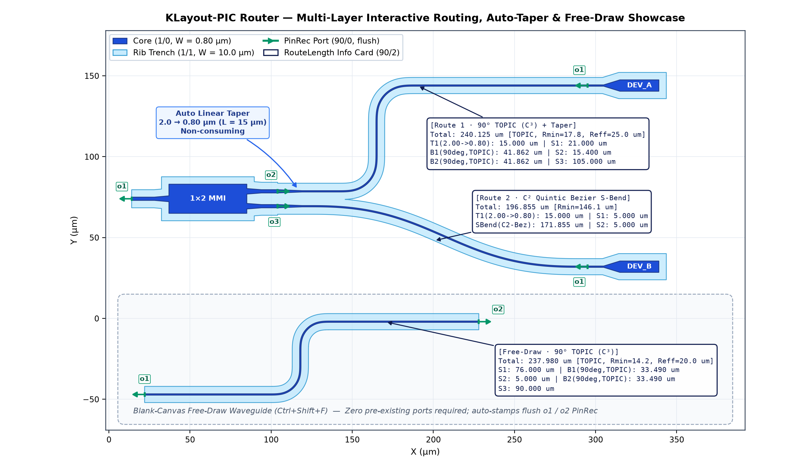
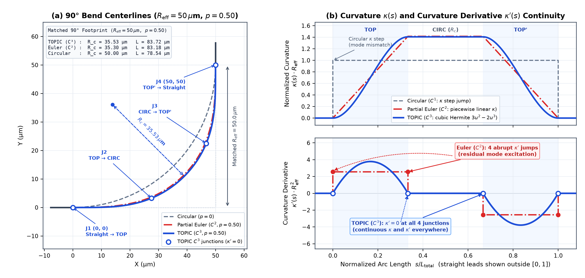
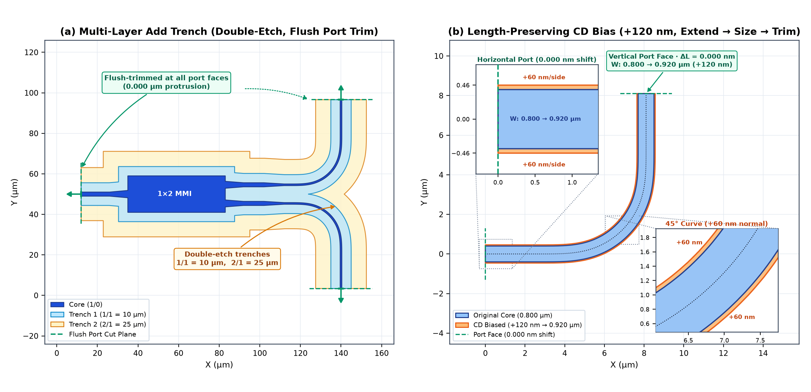

# KLayout-PIC Router

[](LICENSE)
[](https://www.klayout.de/)
[](#安装方式)
[](CHANGELOG.md)

[English](README.md) | [简体中文](README_zh.md)

**KLayout-PIC Router**（Salt 包名 `pic_router`）是一款面向 **KLayout 0.28–0.30+** 的交互式集成光子（PIC）版图拼接与多图层波导布线插件。它将可视化器件摆放与解析级精密布线打通：内置平齐端面 `PinRec` 端口管理、多器件精密对齐与吸附、等宽 **TOPIC（$C^3$）** 与 **部分欧拉（$C^2$）** 弯波导、**$C^2$ 五次贝塞尔 / 升余弦 S 弯**、空白画布**自由画波导（Free-Draw）**、版图后期多层刻蚀槽生成以及保总长 CD 线宽补偿。核心代码采用 **100% 纯 Python** 实现，**零 `numpy` / `scipy` 第三方依赖**，直接运行于 KLayout 内置 Python 环境，适用于 SOI、SiN、InP、AlN、SiO₂/PLC 或任意自定义多层光子工艺。



---

## 核心特性

- **平齐端面端口管理（`PinRec 90/0`）**：端口标记以向内平齐的 `DPath` + `DText` + GDSII `PROPATTR` 元数据保存在 Cell 局部坐标系中，绝不撑大器件外框，GDSII 保存与重新打开后完全保留。支持一键 **`Auto-Detect / Refresh Ports`**（`Ctrl+Shift+D`，自动处理旋转、镜像及任意斜端面，并在 CD Bias 或改图后一键刷新端口宽度）与逐边点击打标 **`Add Port (Click Edge)`**（`Ctrl+Shift+P`）。
- **高精度对齐与吸附**：提供交互式 **`Snap 2 Ports`**（`Ctrl+Shift+S`）、一键 **`Quick Snap Selected Cell`**（`Ctrl+Shift+K`）、单轴 **`Align X`**（`Ctrl+Shift+X`）/ **`Align Y`**（`Ctrl+Shift+Y`）直连预对齐，以及对称双端口居中 **`Center Pair (2->2)`**（`Ctrl+Shift+M`），全面兼容任意旋转与镜像（`r0*`）实例。
- **低损耗连续曲率弯波导引擎**：
  - **TOPIC（$C^3$ Hermite）** *（默认）*：不仅曲率 $\kappa(s)$ 连续，且在全部 4 个直/过渡/圆弧交界处满足 $\kappa'(s) = 0$，有效抑制弯道过渡区模式失配。
  - **部分欧拉（$C^2$ 回旋线）**：内置 16 点 Gauss–Legendre 菲涅尔积分实现，与 `scipy.special.fresnel` 精度偏差 $< 10^{-13}$，无需任何科学计算依赖库。
  - **$C^2$ 零端点曲率 S 弯**：支持 **五次贝塞尔（Quintic Bezier）** 与 **升正弦（Raised-Sine）** S 弯，并可选 **`Integer um Length`**，在不移动器件的前提下通过解析微调 $R_{\mathrm{eff}}$ 或短直段实现精确整数微米光程。
- **纯直段手动布线 & 空白画布自由画波导（`Ctrl+Shift+F`）**：布线时按住 `Shift` 可锁定水平/垂直正交拖拽；也可直接用方向键 + 键盘数字键 + `Enter`/`Tab`（或右侧面板 `Add Straight` 输入栏）精确追加指定长度的纯直段，并用右键或 `Backspace` 无损撤回。**`Free Draw Waveguide`** 无需预先放置器件或端口，在空白画布上即可直接绘制多层 TOPIC/Euler 波导，按 `Enter` 完成时自动在两端打上平齐的 `o1`/`o2` 端口。
- **工艺中立内置模板 + 本地 JSON 自定义预设**：自带 3 套通用起步模板（`Core Only (Single Layer)`、`Core + Trench (Rib)`、`Double Etch (2 Trenches)`），`Core L/D` 与 `Trench L/D` 均支持分号分隔多层与独立宽度语法（如 `1/1=10; 2/1=25`）。调好工艺参数后点面板 **`Save`** 即可持久化保存至本地 `pic_router_presets.json`，随时调用或通过 **`Del`** 删除。
- **不侵占直段长度的自动线性 Taper**：开启 **`Auto Taper Port Widths`** 后，若端口宽度与当前布线 `Core W` 不同，系统自动在直波导与弯道之外预留并插入线性锥形过渡段（`Taper L`），不会吃掉你设定的纯直段长度（`S1`、`S2`...）。
- **无重叠 `RouteLength (90/2)` 标注 & `Routes (ΔL)` 路径长度对比面板**：高对比度深藏青色（`#0F1C4D`）画布标注支持 `Compact Card`（默认信息卡）、`Per-Segment`、`Total Only` 三种风格；配合 **`Routes (ΔL)`** 标签页，可双击定位波导、`Ctrl` 多选两条波导直接读取光程差 $\Delta L$，并一键复制到剪贴板。
- **版图后期掩模处理（多层刻蚀槽 & 保总长 CD Bias）**：
  - **`Add Trench (Multi)...`**：为已有的纯芯层（Core-only）器件或整版一键生成单层/双层刻蚀槽（如 `1/1=10; 2/1=25`），并在所有端口端面平齐裁剪，零外凸。
  - **`CD Bias (ΔW nm)...`**：支持各向同性或 X/Y 各向异性线宽补偿（如 `+120 nm` 即每侧法向加宽 `+60 nm`），采用 **Extend → Size → Flush Trim** 流程，横、竖、斜及曲线弯道线宽同步均匀补偿，同时保证端口坐标与中心线总光程变化严格为 `0.000 nm`。
- **独立参数化 PCell 库（`PIC_Router`）**：内置可实时编辑的 **`EulerWaveguide`**、**`TOPICBend`**、**`EulerBend`** 三个 PCell，并提供 **`Create TOPIC Bend (90° / Custom)...`** 交互式向导对话框，实时预览 $R_c$、$\theta_p$、弧长与占地尺寸。

---

## TOPIC（$C^3$）与部分欧拉（$C^2$）、圆弧弯道对比

等宽 **TOPIC**（*Transition-Optimal-Path Integrated Curve*）弯波导在过渡段采用三次 Hermite 曲率律 $\kappa(u) = (3u^2 - 2u^3)/R_c$（$u \in [0, 1]$），平滑衔接到中心圆弧（半径 $R_c$）并对称退出。下图展示了相同等效半径（$R_{\mathrm{eff}} = 50\,\mu\mathrm{m}$）和过渡比例（$p = 2\theta_p/|\theta_t| = 0.50$，即 $90^\circ$ 弯对应 $\theta_p = 22.5^\circ$）下的三种 $90^\circ$ 弯道对比：

- **纯圆弧（$C^1$）**：入口与出口处曲率 $\kappa$ 发生阶跃突变，直弯过渡模式失配损耗最大。
- **部分欧拉（$C^2$）**：曲率 $\kappa(s)$ 连续，但曲率导数 $\kappa'(s)$ 在 4 个交界处存在 **4 次尖锐阶跃跳变**，仍会激发残余高阶模。
- **TOPIC（$C^3$）**：曲率 $\kappa(s)$ 连续且全部 4 个交界处均满足 **$\kappa'(s) = 0$**，模式绝热演化更平滑，同时在相同占地 $R_{\mathrm{eff}}$ 下保持略大于 Euler 的最小曲率半径 $R_c$。



> **工程默认建议**：推荐保持默认 `Bend Curve = TOPIC (C3)` 与 `Bend p = 0.50`（对应 $90^\circ$ 弯的过渡角 $\theta_p = 22.5^\circ$），在平滑 $C^3$ 过渡与高 $R_c / R_{\mathrm{eff}}$（约 `0.71`）之间取得良好平衡；如有更强弯曲半径裕度需求，也可按需在 $[0.35, 0.65]$ 间调节 `p`。

---

## 版图后期工具：多层刻蚀槽与保总长 CD Bias



- **多层刻蚀槽生成（左图）**：针对外部导入或手工绘制的纯芯层器件（如 1×2 MMI、分光器、独立弯道等），通过 **`Add Trench (Multi)...`** 一次生成单层或多层刻蚀槽（如 `1/1=10; 2/1=25`），并依据 `PinRec` 或自动检测端口将槽体在端面处精确平齐裁剪（`0.000 μm` 外凸），可选实心槽或镂空套筒（`Trench minus Core`）。
- **保总长 CD 线宽补偿（右图）**：在光刻/刻蚀工艺偏置补偿（如总宽 `+120 nm`，即双侧各 `+60 nm`）中，通过 **端面外延 → 法向 Sizing → 端面平齐回切** 算法，使水平直段、竖直直段与 $45^\circ$ 曲线弯道获得一致的法向加宽，同时保证所有端口端面坐标与中心线总光程偏移严格为 `0.000 nm`。

---

## 安装方式

**环境要求**：KLayout **0.28 / 0.29 / 0.30+**（兼容 Qt5 与 Qt6），**无需安装 `numpy` / `scipy` 或配置独立 Python 环境**。

### Windows（一键安装）

1. 下载并解压发布包 `KLayout-PIC-Router_v0.1.0.zip`（或克隆本仓库）。
2. 双击运行 **`install_windows.bat`**（仓库内位于 `scripts\install_windows.bat`）。
   - 插件会自动安装到 `%USERPROFILE%\KLayout\salt\pic_router`（若设置了环境变量 `KLAYOUT_HOME`，则安装至其下 `salt\pic_router`）。
   - 如需卸载，执行：`scripts\install_windows.bat --uninstall`。
3. 重启 KLayout。

### Linux / macOS

在仓库根目录（或解压后的发布目录）执行：

```bash
# 标准复制安装到 ~/.klayout/salt/pic_router
bash scripts/install_linux_mac.sh

# 开发者软链接模式（修改仓库代码后重启 KLayout 即生效）
bash scripts/install_linux_mac.sh --symlink

# 查看安装状态 / 卸载
bash scripts/install_linux_mac.sh --status
bash scripts/install_linux_mac.sh --uninstall
```

### 手动安装

将仓库中的 `grain.xml`、`pymacros/` 和 `python/` 三个目录/文件复制到 KLayout 的 Salt 插件目录即可：

- **Windows**：`%USERPROFILE%\KLayout\salt\pic_router\`
- **Linux / macOS**：`~/.klayout/salt/pic_router/`

### 开启 KLayout 编辑模式（必选）

如果 KLayout 当前处于只读 Viewer 模式，请先开启编辑模式：

- **图形界面**：菜单 `File -> Setup -> Application -> Editing Mode`，勾选 **Editing mode by default**，点击确定并重启 KLayout。
- **命令行**：使用 `klayout -e` 启动。

启动后，顶部菜单栏会出现 **`PIC Tools`**，右侧将自动停靠 **`PIC Snap & Router`** 面板（可随时按 `Ctrl+Shift+T` 显隐）。

---

## 快速上手与工作流指南

### 1. 工艺截面模板与本地自定义预设保存

面板顶部 **Cross-Section & Route Params** 内置 3 套通用模板：

| 内置模板 | 芯层与线宽 | 刻蚀槽层与宽度 | 默认 $R_{\mathrm{eff}}$ | 默认 $p$ | 最小直段 |
| :--- | :--- | :--- | :---: | :---: | :---: |
| `Core Only (Single Layer)` | `1/0`（`0.50 μm`） | 关闭 | `20.0 μm` | `0.50` | `5.0 μm` |
| `Core + Trench (Rib)` *（默认）* | `1/0`（`0.80 μm`） | `1/1`（`10.0 μm`） | `50.0 μm` | `0.50` | `5.0 μm` |
| `Double Etch (2 Trenches)` | `1/0`（`0.80 μm`） | `1/1`（`10.0 μm`）、`2/1`（`25.0 μm`） | `50.0 μm` | `0.50` | `5.0 μm` |

- **多层与独立宽度写法**：`Core L/D` 与 `Trench L/D` 支持用英文分号 `;`（或中文全角 `；`）分隔多层，并用 `=` 或 `@` 指定单层宽度，例如 `1/1=10; 2/1=25`、`1/0; 2/0=4.0`。
- **保存自己的工艺预设**：修改图层、线宽、弯道半径、过渡比例 `Bend p` 与最小直段后，点击 `Preset` 下拉框右侧的 **`Save`** 按钮输入预设名称，即可持久化保存至本地 `pic_router_presets.json`（位于 KLayout 用户配置目录）。不再需要的自定义预设可点 **`Del`** 删除（内置模板受保护）。

### 2. 空白画布自由画波导（`Ctrl+Shift+F`）

无须先摆放任何器件，即可直接绘制带刻蚀槽的 TOPIC/Euler 多层波导：

1. 点击 **`Free Draw Waveguide`**（或按 `Ctrl+Shift+F`）。
2. 在画布任意位置左键确定起点（自动对齐到 `1 μm` 网格；若靠近已有端口则自动吸附）。
3. 沿水平/垂直方向拖动并点击添加路径段；也可按**方向键**（`← ↑ → ↓`）选定方向后，直接**键盘敲入精确长度数字**（如 `120`）再按 `Enter`/`Tab`（或使用面板上的 **`Straight L (um)` + `Add Straight`**）。每次 $90^\circ$ 转弯都会自动生成 TOPIC/Euler 弯道，并严格保留每段纯直段长度。
4. 画错任何一段可直接**右键**或按 **`Backspace`** 无损回退。
5. 清空数字输入后按 **`Enter`**（或点击某个已有端口）即生成可继续参数化编辑的 `EulerWaveguide` PCell，并在自由端自动生成平齐的 `o1` / `o2` `PinRec (90/0)` 端口，方便后续直接拼接其他器件。

### 3. 自动识别端口与刷新端口（防 Taper 错配）

1. 选中目标器件实例（不选则扫描当前顶层 Cell），点击 **`Auto-Detect / Refresh Ports`**（`Ctrl+Shift+D`）。
2. 该操作会清除旧的 `PinRec (90/0)` 标记并按当前实际几何重新打标。**特别提示**：对版图执行原地 **CD Bias** 或手动修改线宽后，务必执行一次 **`Auto-Detect / Refresh Ports`** 更新端口记录宽度，避免开启 **`Auto Taper Port Widths`** 时因旧端口宽度与新线宽不一致而误插不必要的 Taper。
3. 需要单独补充某一端面端口时，使用 **`Add Port (Click Edge)`**（`Ctrl+Shift+P`）点击端面附近即可。
4. 在 **`World Ports`** 标签页中可按名称/图层筛选端口，并点击 **`Alias`** 为重复实例设置持久化的 GDSII 别名。

### 4. 精密对齐与一键吸附

- **`Snap 2 Ports`**（`Ctrl+Shift+S`）：依次点击待移动器件端口与目标端口，实现端面零缝隙精准对接；勾选 **`Allow Rotate on Snap`** 可自动匹配旋转角度（支持镜像单元与斜端面）。
- **`Quick Snap Selected Cell`**（`Ctrl+Shift+K`）：选中一个器件实例，一键吸附至距离最近的兼容邻近端口。
- **`Align X (2 Ports)`**（`Ctrl+Shift+X`）/ **`Align Y (2 Ports)`**（`Ctrl+Shift+Y`）：仅沿 X 或 Y 单轴平移待移动器件，使两端口严格共线，直接引出无弯直连波导。
- **`Center Pair (2->2)`**（`Ctrl+Shift+M`）：依次点选待移动器件的两个端口与目标器件的两个端口（或在 **`World Ports`** 表格选中 4 行后点击 **`Center Pair (4 Rows)`**），将双端口器件精确居中对齐。

### 5. 自动布线与纯直段手动布线（`Ctrl+Shift+R`）

1. 按 `Ctrl+Shift+R`（或点击 **`Route 2 Ports (Shift=H/V)`**）并点击起点端口 **Port A**。
2. **自动布线**：直接点击终点端口 **Port B**。平行错位端口会按 **`Auto Route`** 选项生成 `S-Bend (C2 Bezier)`、`S-Bend (C2 Sine)`、`90° Bend + Straight`、`Auto (Best)` 或 `Straight Only`；$90^\circ$ L 型与 U 型转弯始终使用 $90^\circ$ TOPIC/Euler 弯道 + 直段。勾选 **`Integer um Length`** 可在不挪动器件的前提下解析调出精确整数微米总长。
3. **纯直段手动布线**：点完 **Port A** 后，按住 **`Shift`** 拖动水平/垂直路径并点击拐点，或用方向键 + 数字键 + `Enter`/`Tab`（以及面板 `Add Straight`）精确逐段拉出纯直段，最后点击 **Port B** 完成。手动布线严格保持你输入的每一段纯直段长度（`S1`、`S2`...）以及统一固定的弯道半径 $R_{\mathrm{eff}}$。
4. **Path 与 PCell 互转**：可将手工绘制的 KLayout `Path` 一键转换为多层波导 PCell（`Ctrl+Shift+W`），也可随时将选中的 `EulerWaveguide` PCell 还原为原始 `DPath`（`Ctrl+Shift+E`）。
5. **光程核对与 $\Delta L$ 测量**：切换到 **`Routes (ΔL)`** 标签页，双击任意路由可自动缩放到视野中心；按住 `Ctrl` 选中两条波导即可在下方蓝色状态条直接读取精确光程差 $\Delta L$，并支持 **`Copy Lengths`** 导出与 **`Relayout 90/2`** 全局避让重排标注。

### 6. 独立生成 TOPIC 弯波导

点击 **`Create TOPIC Bend (90° / Custom)...`**（或菜单 `PIC Tools -> Create TOPIC Bend (Constant Width, R_eff & p)...`）：

- **`TOPIC Fraction p (0..1)`** 与 **`Transition Angle θ_p (deg)`** 双向实时联动（$\theta_p = \frac{1}{2} p |\theta_t|$）。
- 底部信息框实时计算并显示 $R_c$（$R_{\min}$）、过渡段长 $L_{\mathrm{TOP}}$、圆弧段长 $L_{\mathrm{CIRC}}$、弯道总长 $L_{\mathrm{bend}}$、占地坐标 $(dx, dy)$ 及含直引线总长。
- 支持添加前后直引线（`Input/Output Straight Lead`）、选择 4 种象限朝向，并自动打上 `o1`/`o2` 平齐端口与 `RouteLength (90/2)` 参数标注。

### 7. 多层加槽（Add Trench）与保总长 CD Bias

- **`Add Trench (Multi)...`**：填写源芯层 `Core L/D`（如 `1/0`）和目标刻蚀槽 `Trench L/D`（如 `1/1=10; 2/1=25`），选择宽度解释模式（**总槽宽** `margin = (W - Core W)/2` 或 **单侧外扩边距**），保持勾选 **`Trim trench flush at port faces`**。对静态版图 Cell 与 `EulerWaveguide`/`TOPICBend`/`EulerBend` PCell 均直接生效。
- **`CD Bias (ΔW nm)...`**：输入总线宽偏置 $\Delta W$（单位 nm，例如 `+120.0` nm 表示将 `0.80 μm` 扩至 `0.92 μm`，即两侧各 `+60 nm`），或勾选 **`Anisotropic X/Y Bias`** 分别设置竖直与水平波导偏置。输出模式默认为安全的 **`New Layer: Datatype + Offset`**（如 `1/0 -> 1/10`），也支持 **`In-Place`** 原地修改（支持完整 `Ctrl+Z` 撤销）或 **`Custom Output L/D`**。保持勾选 **`Preserve port faces & total optical length`** 即可确保端面与光程零漂移。

---

## 快捷键速查表

所有快捷键均采用 `Ctrl+Shift+...` 组合，与 KLayout 默认编辑快捷键零冲突。

| 快捷键 | 功能说明 | 对应菜单 / 面板按钮 |
| :--- | :--- | :--- |
| `Ctrl+Shift+T` | 显示 / 隐藏 `PIC Snap & Router` 面板 | `PIC Tools -> Toggle PIC Router Panel` |
| `Ctrl+Shift+S` | 交互式双端口吸附拼接 | `Snap 2 Ports` |
| `Ctrl+Shift+R` | 交互式双端口 TOPIC/Euler 布线（按住 `Shift` 正交锁轴） | `Route 2 Ports (Shift=H/V)` |
| `Ctrl+Shift+F` | 空白画布自由绘制多层波导 | `Free Draw Waveguide` |
| `Ctrl+Shift+X` | 双端口 X 坐标对齐（竖直直连预处理） | `Align X (2 Ports)` |
| `Ctrl+Shift+Y` | 双端口 Y 坐标对齐（水平直连预处理） | `Align Y (2 Ports)` |
| `Ctrl+Shift+M` | 双端口对之间对称居中对齐（2 对 2） | `Center Pair (2->2)` |
| `Ctrl+Shift+P` | 点击波导端面手动添加 `PinRec` 端口 | `Add Port (Click Edge)` |
| `Ctrl+Shift+K` | 选中器件一键吸附至最近邻近端口 | `Quick Snap Selected Cell` |
| `Ctrl+Shift+D` | 自动检测 / 刷新选中器件的 `PinRec` 端口 | `Auto-Detect / Refresh Ports` |
| `Ctrl+Shift+W` | 选中 `Path` 转换为 `EulerWaveguide` PCell | `Path -> Euler Waveguide` |
| `Ctrl+Shift+E` | 将选中的 `EulerWaveguide` PCell 还原为原始 `DPath` | `Revert WG -> Path` |

**画布交互模式内按键** *（在 `Route 2 Ports` 与 `Free Draw Waveguide` 模式下生效）*：

- **按住 `Shift`**：拖拽时强制锁定水平/垂直正交直段（步进 `1 μm`）。
- **方向键 `←` / `↑` / `→` / `↓`**：指定下一段直波导的前进方向。
- **数字键 `0–9` / `.` + `Enter` 或 `Tab`**：直接输入精确直段长度（单位 μm）并追加。
- **鼠标右键 / `Backspace`**：无损撤回上一个拐点或直段。
- **`Enter`** *（Free-Draw 模式且无待提交数字时）*：结束绘制并生成带 `o1`/`o2` 端口的波导 PCell。
- **`Esc`**：取消当前草稿并退出交互模式。

---

## 辅助图层与 PCell 参数说明

### 辅助图层规范

| 图层 / 数据类型 | 名称 | 说明 |
| :---: | :--- | :--- |
| `90/0` | `PinRec` | 向内平齐的端口标记（`DPath` + `DText` + GDSII `PROPATTR` `10..14`），零外框溢出，GDSII 读写持久化保留。 |
| `90/1` | `RouteGuide` | 可选引导路径辅助层常量（`DEFAULT_GUIDE_LAYER`）。 |
| `90/2` | `RouteLength` | 深藏青色（`#0F1C4D`）光程与 $R_{\min}/R_{\mathrm{eff}}$ 标注层，支持 `Compact Card`、`Per-Segment`、`Total Only`。 |
| `90/99` | `RouteError` | 几何不可行或弯曲半径受限时输出的错误指示路径与说明文本。 |

### `PIC_Router` PCell 库

插件启动后会自动注册 **`PIC_Router`** PCell 库（可在 `Instance -> Library: PIC_Router` 中直接调用，亦支持 Python 脚本实例化）：

| PCell 名称 | 功能描述 | 主要参数 |
| :--- | :--- | :--- |
| **`EulerWaveguide`** | 跟随引导 `DPath` 的多层可编辑波导 | `path`、`preset`、`bend_type`（`topic` / `euler`）、`curve_type`（`euler` / `sbend_bezier` / `sbend_sine`）、`core_width`、`trench_width`、`radius`、`euler_p`、`min_straight`、`use_eff_radius`、`start_width`、`end_width`、`taper_length`、`core_layer`、`trench_layer`、`extra_layers_json`、`sbend_angle_deg`、`add_ports` |
| **`TOPICBend`** | 独立等宽多层 $C^3$ Hermite 曲率弯道 | `angle_deg`、`radius`、`euler_p`（$p = 2\theta_p/|\theta_t|$）、`use_eff_radius`、`straight_in`、`straight_out`、`preset`、`core_width`、`trench_width`、`core_layer`、`trench_layer`、`extra_layers_json`、`add_ports`（默认 `True`，自动生成 `o1`/`o2`） |
| **`EulerBend`** | 独立多层 $C^2$ 部分欧拉回旋线弯道 | `angle_deg`、`radius`、`euler_p`、`use_eff_radius`、`preset`、`core_width`、`trench_width`、`core_layer`、`trench_layer`、`extra_layers_json`、`add_ports`（默认 `True`，自动生成 `o1`/`o2`） |

---

## 参与贡献

欢迎提交 Issue 与 Pull Request！开发环境搭建（`install_linux_mac.sh --symlink`）、单元测试（`pytest`）及 KLayout 无头集成测试（`klayout -b -r tests/test_klayout_headless.py`）说明请参阅 [CONTRIBUTING.md](CONTRIBUTING.md)。

## 参考文献

- **TOPIC（$C^3$ Hermite 曲率）弯波导理论**：Q. Deng *et al.*, *Laser Photonics Rev.* **2025**, 19, 2401357.

## 开源协议

本项目基于 [MIT License](LICENSE) 开源。Copyright © 2026 MeshedPoto.
